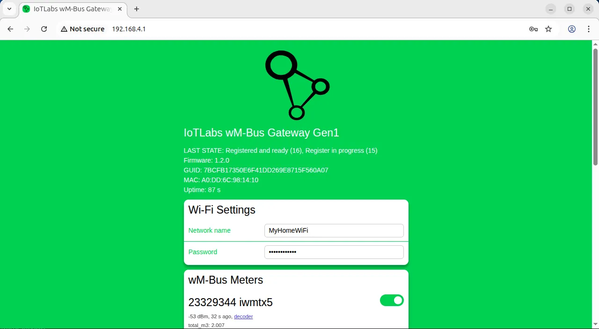
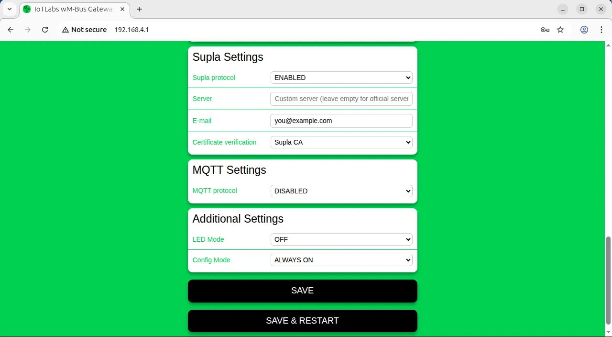
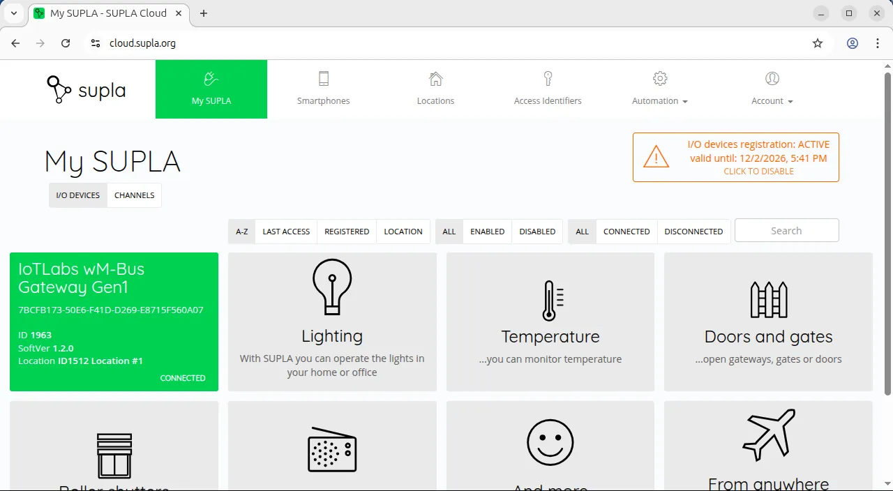
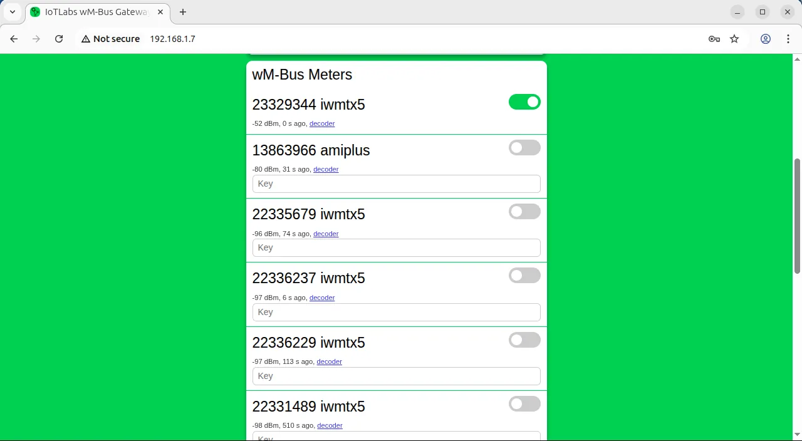
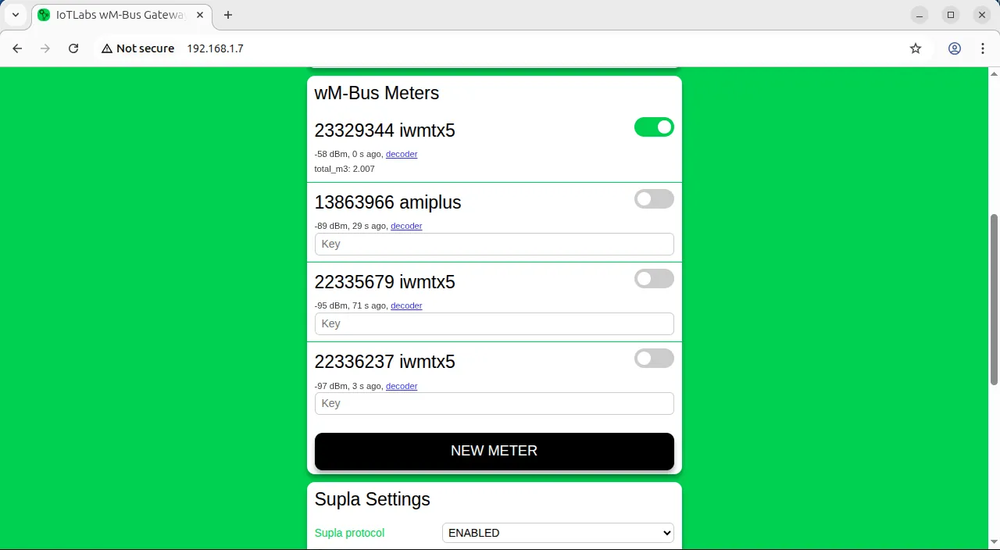
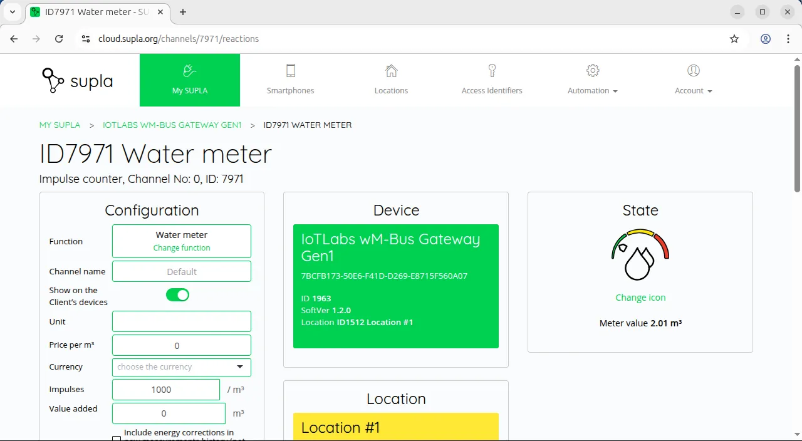

# wM-Bus Gateway

This repository contains the source code for the [**wM-Bus Gateway**](http://github.com/IoTLabs-pl/wM-Bus-Gateway) allowing for communication with [Supla](https://supla.org).

    
    
    

---

## ℹ️ General Info

> ⚠️ **Warning:**  
> **Do not power on the device without the antenna connected** – this may damage the radio module.

- 🟦 The device has two buttons:
  - **Top button** – used to switch pages on the display, entering configuration mode and factory reset of device.
  - **Bottom button** – used to soft reset the device.

---

## 🏠 Getting Started with Supla

You need:

- a [Supla Cloud](https://cloud.supla.org) account,
- a phone or computer with Wi-Fi.

### 1. Enable device registration

Log in to Supla Cloud. On **My SUPLA**, click the **I/O devices registration** notice in the top right corner to turn it on.

### 2. Connect the gateway to Wi-Fi and Supla

Connect the antenna, then plug the gateway into a computer or a USB power adapter. Connect your phone or computer to the gateway's Wi-Fi network `WM-BUS-GATEWAY-…` and open `http://192.168.4.1`. You'll see the network name and address on the gateway's display.

> [!TIP]
> On a phone, turn off mobile data if the page does not open.

Enter the name and password of your Wi-Fi network.

Under **Supla Settings**, enter the e-mail of your Supla Cloud account and set **Config Mode** to `ALWAYS ON` so you can open this page from your home network in step 4. Click **Save & Restart**.

### 3. Find the gateway in Supla Cloud

The gateway joins your Wi-Fi network and registers in Supla Cloud. It will show up on **My SUPLA** as **CONNECTED**.

### 4. Choose your meters

Open the gateway's page again, now at its address in your local network (shown on the gateway's display). The **wM-Bus Meters** list shows every meter the gateway hears, strongest signal first, along with its detected driver. Meters send their readings every few seconds to a few minutes, so give it a moment and reload the page. Find yours by the serial number printed on the meter.

Enable your meter on the list. If its transmission is encrypted, enter its key — you can get it from your utility company or the meter's installer. The **decoder** link opens the meter's last frame in the [IoTLabs decoder](https://iotlabs.pl/decoder), which is handy for testing the key. Click **Save & Restart**.

### 5. Check the readings

After the next frame arrives, the gateway's page shows the readings below the meter — or a decoding error, such as `decryption_failed` if the key is wrong. The gateway picks the right readings automatically:

- for water, gas, and heat meters: the meter total,
- for electricity meters: energy, power, voltage, current, and frequency (per phase, if the meter reports them).

Each meter appears as its own channel under the gateway in Supla Cloud and the Supla app, where you can set prices, units, or hide unused phases for single-phase meters.

---

## ❓ FAQ

### How to disable built-in LED?
You can disable the built-in LED in the device configuration page by setting the `LED Mode` option to `OFF`. With `ON` option, the LED will blink for any received wM-Bus datagram. With `ON METER MATCH`, the LED will blink only for datagrams matching the configured meter IDs.

### How to enter config mode?
To enter the configuration mode, press and hold the **top button** longer than 5 but less than 12 seconds. The device will start LED blink. SSID and IP address of the device will be displayed on the screen. You may also command the device to enter configuration mode through **Supla Cloud**. 

### How to factory reset the device?
To factory reset the device, press and hold the **top button** for more than 12 seconds. The device will restart with all user-specified data erased. You will need to reconfigure the device from scratch.

### How to update the firmware?
A simple web flasher based on [ESP Web Tools](https://esphome.github.io/esp-web-tools/) is available at: [https://iotlabs.pl/tools](https://iotlabs.pl/tools). It will allow you to change device firmware to any version available on Github.

---

## 🌐 More Information

More info about the device can be found at:  
👉 [https://iotlabs.pl/wm-bus-gateway/](https://iotlabs.pl/wm-bus-gateway/)